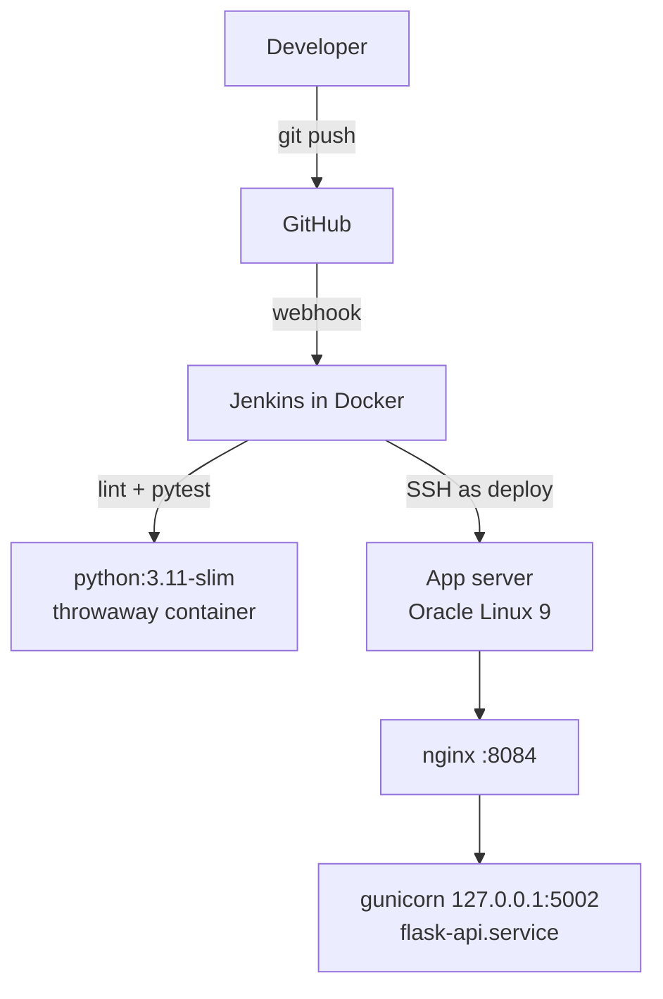

# jenkins-flask-api-pipeline

Flask API CI/CD on Oracle Cloud Infrastructure. A push to `main` triggers Jenkins through a GitHub
webhook. Lint and unit tests run in a disposable Python container; if they pass, the API is released
on an Oracle Linux app server in its own virtualenv, restarted under systemd, and health-checked
through nginx. An unhealthy release is rolled back automatically.

Lab 2 of a series of CI/CD labs on OCI (GitHub · Jenkins · Docker · Oracle Linux app server).
Builds on [Lab 1](https://github.com/abdulzaferdevops/jenkins-static-site-deploy).

## Architecture



## The API

| Endpoint | Returns |
|:--|:--|
| `GET /health` | `status`, `release`, `commit`, `built`; used by the pipeline to confirm which build is live |
| `GET /api/items` | The catalogue; filters `?category=network` and `?low_stock=5` |
| `GET /api/items/<id>` | One item, or a JSON 404 |

## Pipeline

| Stage | What it does |
|:--|:--|
| Preflight | Checks `APP_HOST`, Docker access and the SSH connection; names the release `<build>-<commit>` |
| Lint & test | Blocks committed private keys; runs `flake8` and `pytest` in `python:3.11-slim`; results shown in Jenkins |
| Package | App, data and dependencies list, plus a `RELEASE` file recording build and commit |
| Deploy | Builds the release's own virtualenv, switches `current`, restarts the service, checks `/health` |
| Smoke test | Calls a real API endpoint through nginx |
| Rollback | Manual: `ACTION=rollback` returns to the previous **healthy** release |

### What happens when a release is bad

| Failure | Outcome |
|:--|:--|
| Lint or a test fails | Nothing is deployed |
| Dependencies fail to install | Release discarded; the live service is never touched |
| Service won't start, or `/health` reports the wrong release | Previous release restored and restarted automatically; build marked failed |

Only releases that passed their health check are marked healthy, so a rollback never lands on a broken one.

## Release layout on the app server

```
/opt/flask-api/
├── current -> releases/00012-9c1d2e3
├── releases/
│   ├── 00011-4ab09f1/   app.py  data/  RELEASE  venv/  .healthy
│   └── 00012-9c1d2e3/   app.py  data/  RELEASE  venv/  .healthy
└── shared/app.env       # runtime settings, not in git
```

## Security choices

- Service runs as the unprivileged `deploy` user with `NoNewPrivileges` and a private `/tmp`.
- gunicorn listens on localhost only; nginx is the single entry point.
- The deploy user's sudo rule allows **only** restarting and inspecting `flask-api.service`.
- The deploy key works only from the lab subnet; the host key is pinned (see Lab 1).
- Tests run in a throwaway container as the Jenkins user, not as root.
- No secrets or server addresses in the repo.

## Run locally

```bash
python -m venv .venv && . .venv/bin/activate
pip install -r requirements-dev.txt
flake8 && pytest
flask --app app run   # http://127.0.0.1:5000/health
```

## Licence

MIT
